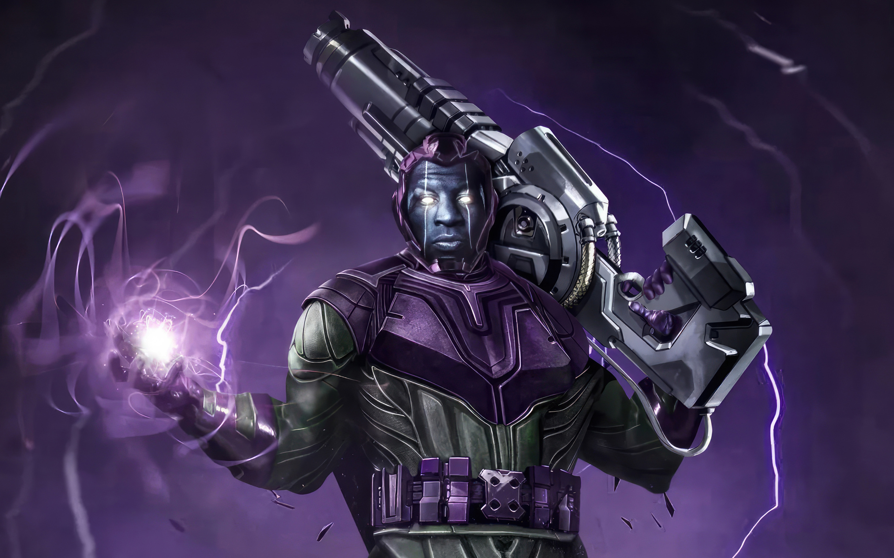
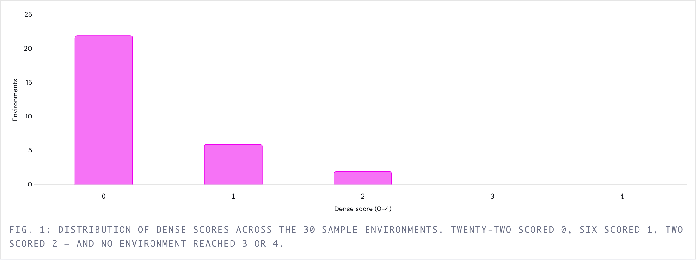
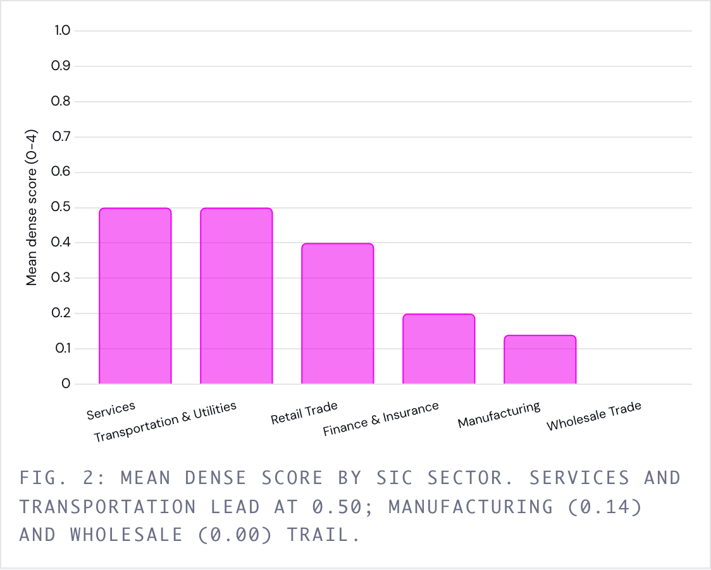
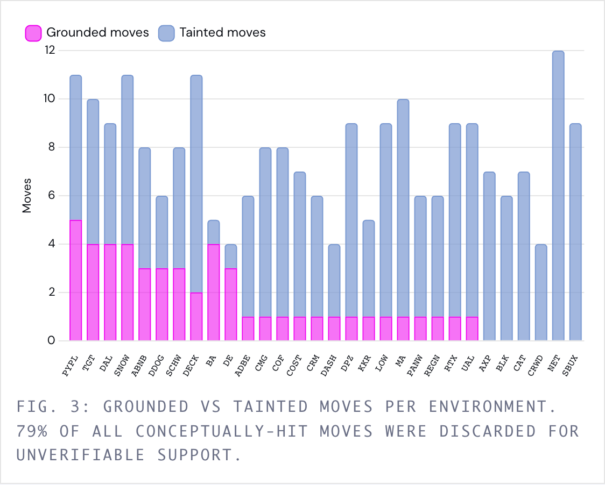

# Kang — Sample Tasks

Kang is a reinforcement-learning environment for training and evaluating agents on hard,
open-ended **financial-analyst reasoning**. This repository is the public **sample task
library**: 30 complete, self-contained, ready-to-run environments.

[](LICENSE)



Each task drops an agent into a sandboxed container stocked with a point-in-time corpus of
regulatory filings and financial statements, hands it an open-ended research topic, and scores
the written analysis against an explicit rubric of the analytical *moves* a competent analyst
would make. That rubric-anchored score is the reward.

Where most finance benchmarks terminate in a keyed answer, Kang rewards **the argument itself**:
decomposing a theme into the right sub-questions, grounding every claim in the source documents,
engaging the strongest counter-evidence, and reconciling conflicting data points into a single
defensible view.

Nothing here is scraped from analyst notes, forums, or any public answer key. The corpus is
fetched directly from primary regulatory sources; the rubrics are authored against those filings
and fact-checked line by line before a task ships.

---

## What's in this repository

| | |
|---|---|
| **Tasks** | 30 |
| **Companies** | 30 distinct US-listed issuers |
| **Point-in-time cutoff** | `2026-06-30` (uniform) |
| **Corpus** | 808 files, ~109 MB total (~27 files / ~3.5 MB per task) |
| **Rubric shape** | 4 themes per task, 12–14 lettered moves |
| **Per task** | prompt, corpus, Dockerfile, rubric, 3-pass grader, reference reasoning trace, two recorded baseline trajectories |
| **Baselines** | `claude-opus-4-8` and `gpt-5.6-sol`, one run each on all 30 tasks |

Every task directory is named by a stable UUID, so task identity survives renaming a ticker,
a topic, or a cutoff.

---

## Task anatomy

```text
<uuid>/
  Instruction.md                  # The open-ended prompt the agent sees
  Truth.md                        # Reference reasoning trace (phase-by-phase analyst process)
  task.toml                       # Harbor config: artifacts, timeouts, resources, difficulty note
  environment/
    Dockerfile                    # ubuntu:24.04 + python3 + uv; copies data/ to /app/data
    data/                         # Point-in-time corpus (mounted read-only at /app/data)
      company_profiles.json       #   primary + peer profiles
      financials/
        income_statement/         #   up to 16 quarters, primary + peers
        balance_sheet/            #   up to 16 quarters, primary only
        cash_flow/                #   up to 16 quarters, primary + peers
      sec_filings/
        10-k/                     #   ~3 annual reports (full text)
        10-q/                     #   ~6 quarterly reports (full text)
        s-1/                      #   IPO prospectus (13 of 30 tasks)
      press_releases/             #   ~8 earnings press releases (8-K EX-99 exhibits)
  tests/
    test.sh                       # Verifier entry point
    grade.py                      # Three-pass LLM-as-judge grader
    grading_prompt_task1..3.md    # Grounding, coverage, synthesis prompts
    ground_truth.txt              # The rubric: themes, lettered moves, source files
    rubrics.json                  # Process-level criteria for trajectory verification
    test_outputs.py               # Deterministic invariants (answer present, cited files real, …)
  trajectories/
    claude-opus-4-8/              # Baseline run: answer, trajectory, score breakdown
    gpt-5.6-sol/                  # Second baseline run, same layout
```

The agent writes its full analysis to **`/app/answer.txt`**, which is the only artifact graded.

---

## Where the data comes from

Every corpus is machine-fetched from **primary regulatory sources**. No vendor feeds, no scraped
analyst content, no LLM-generated documents.

### The four gates

A source is only wired into the pipeline if it passes **all four**:

1. **Free** — no paid subscription (a free-registration key is tolerated, not preferred).
2. **English** — the filing *text* must be English, because the grader verifies quotes **verbatim**.
3. **Clean API** — a machine-readable JSON/XBRL endpoint, not a fragile page scrape or a pile of PDFs.
4. **Point-in-time** — real filing dates, so nothing dated after the cutoff can leak into the corpus.

### Sources in the pipeline

| Region | Source | Tier | Role |
|---|---|---|---|
| 🇺🇸 US + global ADRs | **SEC EDGAR + XBRL Company Facts** | structured | The backbone. Every task in this repo. |
| 🇮🇳 India | **BSE** | text | Keyless route for India-only names; financials best-effort. |
| 🇭🇰 Hong Kong | **HKEXnews** | text | The English doorway to HK/mainland-Chinese names with no US listing. |

**The insight that shapes the whole pipeline:** a foreign company with a **US listing** files its
annual report as a **20-F / 40-F / 6-K / F-1 — in English, free, on SEC**. So most large European
and Asian names are best fetched through SEC, *not* their home regulator. A local source only
matters for a company with **no** US listing. All 30 tasks in this release are SEC-sourced.

Sources evaluated and rejected — Canada (SEDAR+, CAPTCHA-walled), Australia (ASX, no point-in-time
fetch), Taiwan (MOPS, Chinese labels + latest-period-only), EU (ESEF, 27 fragmented national
systems), India NSE (Akamai anti-bot, redundant with BSE), Singapore, UK FCA NSM, and company IR
pages.

### What SEC gives, and what it doesn't

**Gives:** up to 16 quarters of authoritative XBRL financials (US-GAAP *and* IFRS-tagged foreign
filers), full 10-K / 10-Q / S-1 text, 8-K EX-99 earnings press releases, and company profiles —
all with real filing dates.

**Doesn't give, and we don't fake:**

- **No earnings-call transcripts.** SEC has none. This is structural across every free source.
  Rubric themes are authored so they never require what management said on a call.
- **No market prices.** Optional yfinance enrichment exists in the fetcher but is not used in
  this release.
- **Q4 gaps** — many issuers report Q4 only inside the 10-K, so the quarterly series has holes.
- **Tables flatten** in HTML→text conversion. Prose reads cleanly; filing tables lose structure.
  Numbers are therefore taken from the XBRL JSON, not from filing tables.

---

## The rubric

`tests/ground_truth.txt` is a preface (concept-match rule, synthesis requirement, grounding rule)
followed by numbered themes. Each theme carries a one-paragraph thesis, its lettered moves, and
its `Source:` line:

```text
2. Billings / RPO / Deferred-Revenue Durability as a Forward-Demand Signal
Remaining performance obligations grew from $15.8 billion to $18.4 billion, but management
cautions that RPO and deferred revenue should be viewed independently of GAAP revenue, so
their durability as a demand signal must be tested rather than assumed.
[a] Track RPO growth ($15.8B at July 31, 2025 to $18.4B at April 30, 2026) and the near-term
    recognizable portion (~$7.0B rising to $8.3B over the next 12 months) …
[b] Cross-check RPO against current and long-term deferred-revenue balances, and separate
    organically driven backlog from growth pulled forward by financing terms and by M&A.
[c] Engage the strongest counter-evidence: management's own caveats that these metrics do not
    represent revenue under U.S. GAAP or a revenue forecast.
Source: sec_filings/10-k/panw_2025_10-k.txt, sec_filings/10-q/panw_2026q3_10-q.txt, …
```

Credit is awarded on **concept match, not vocabulary match** — the example phrasing illustrates
the move; any equivalent framing satisfies it.

Beyond covering the themes, `Instruction.md` requires the agent to take a clear position rather
than survey both sides, engage the strongest counter-evidence in the data, reconcile conflicting
data points into a unified conclusion, note ambiguity instead of smoothing it over, and
**inline-cite the source file behind every claim**. Claims that cannot be grounded in a provided
file earn no credit.

---

## Reward

Kang grades long-form prose with no single correct wording, so scoring runs an LLM judge at
temperature 0, JSON-constrained, against the rubric. Each run records the judge that scored it in
`verifier/report.json`; the two shipped baselines were graded cross-family, see
[Baseline results](#baseline-results). The judge runs as **three passes**, so factual grounding
and analytical coverage are scored separately and then combined:

**1. Grounding.** The grader reconstructs the evidence the agent relied on by loading exactly the
files it cited, extracts every specific factual claim (figures, quotes, named entities, dates,
comparisons), and flags any the cited sources don't support. Framings and inferences are fine as
long as their building blocks are present. The bar is: *did the agent invent a fact.*

**2. Coverage.** For each theme, the judge reports which lettered moves the answer hits by concept
match. A move whose supporting evidence was flagged in pass 1 is marked **tainted** and does not
count — so a fabricated figure forfeits only the move it taints, not the whole answer.

**3. Synthesis.** The judge checks for at least one explicit synthesis that reconciles opposing
data points into a unified conclusion, as opposed to listing considerations in parallel. This
gates the top score.

### Theme coverage

A theme with `n` moves counts as covered once the agent lands enough **untainted** moves to clear:

```
tau = max(1, min(n - 1, 3))
```

The `n - 1` term allows one miss per theme; the cap at `3` keeps move-rich themes from demanding a
near-perfect hit rate. In this library that means a 3-move theme needs 2, and a 4-move theme
needs 3.

### Score

Every task in this release has `T = 4` themes. From the number of covered themes `C`:

| `C` covered | 0 | 1 | 2 | 3 | 4 | 4 + synthesis |
|---|---|---|---|---|---|---|
| **Dense score** | 0 | 1 | 2 | 2 | 3 | **4** |

The sparse pass/fail signal is derived from the dense score: **a trial passes only at a perfect 4**.

The harness writes the sparse reward to `/logs/verifier/reward.txt` (`1` or `0`) and the full
breakdown to `/logs/verifier/details.json`.

### Reading `details.json`

| Field | Meaning |
|---|---|
| `score` | Dense 0–4. |
| `sparse_reward` | `1` iff `score == 4`. This is pass@1. |
| `valid_trial` | `false` when a judge pass returned unparsable output. **Exclude these from any metric** — they are grader failures, not agent failures. |
| `themes_hit` / `themes_missed` | Per theme: `moves_hit`, `moves_tainted`, `move_reasoning`, `threshold`/`n_moves`. |
| `unverifiable_claims` | Every claim the grounding pass could not verify, with the file searched and why it was flagged. |
| `hallucinations_detected` | Whether pass 1 flagged anything. |
| `synthesis_found` | The quoted synthesis sentence, or `null`. |
| `cited_files` | The data files the answer actually cited — the exact evidence set pass 1 verified against. |

> A judge failure writes `0` to `reward.txt` **and** sets `valid_trial: false`. Averaging
> `reward.txt` without filtering on `valid_trial` silently contaminates your metric with grader
> infrastructure failures.

Use the dense score for reward shaping during training and pass@1 for evaluation.

## Composition

30 tasks across the recurring topics that define analyst work — valuation, growth durability,
M&A integration, competitive positioning, operational execution, and risk. All are point-in-time
as of **2026-06-30**, each with 2–3 named peers whose income statements and cash flows ship in
the corpus.

**Software, Security & Infrastructure (7)**

| Ticker | Topic |
|---|---|
| ADBE | Generative-AI disruption risk vs. the Creative Cloud moat |
| CRM | Growth deceleration vs. operating-margin expansion |
| CRWD | Durability of security growth and retention after the 2024 outage |
| DDOG | Usage-based growth durability and platform competition |
| NET | Growth durability and operating-leverage inflection |
| PANW | Platformization strategy and billings/RPO durability |
| SNOW | Consumption-revenue growth durability and margin path |

**Financials (7)**

| Ticker | Topic |
|---|---|
| AXP | Premium-spend durability and credit-cost normalization |
| BLK | Net flows, fee-rate mix, and the private-markets buildout |
| COF | Credit normalization and the Discover acquisition integration |
| KKR | Franchise growth and insurance-driven earnings mix |
| MA | Cross-border volume durability and value-added-services growth |
| PYPL | Branded-checkout turnaround and transaction-margin stabilization |
| SCHW | Deposit and net-interest-income recovery post cash-sorting |

**Consumer & Retail (7)**

| Ticker | Topic |
|---|---|
| CMG | Traffic and margin durability against maturing unit growth |
| COST | Membership-growth durability and margin/fee dynamics |
| DECK | HOKA and UGG growth durability and brand concentration |
| DPZ | Same-store-sales recovery and unit-growth durability |
| LOW | Comparable-sales recovery and Pro penetration vs. Home Depot |
| SBUX | US traffic turnaround and China competitive pressure |
| TGT | Traffic recovery and operating-margin normalization |

**Industrials, Aerospace & Transport (6)**

| Ticker | Topic |
|---|---|
| BA | Recovery credibility, cash burn, and 737/787 execution |
| CAT | Construction cycle and backlog durability |
| DAL | Premium-revenue mix and balance-sheet deleveraging |
| DE | Ag-cycle downturn severity and precision-agriculture durability |
| RTX | Commercial-aftermarket recovery vs. the GTF powder-metal charge |
| UAL | Unit-revenue and margin durability against capacity growth |

**Internet & Marketplaces (2)**

| Ticker | Topic |
|---|---|
| ABNB | Growth durability and take-rate expansion vs. regulatory risk |
| DASH | Margin inflection and new-vertical expansion durability |

**Healthcare (1)**

| Ticker | Topic |
|---|---|
| REGN | Eylea competitive erosion and pipeline offset |

---

## Baseline results

Two recorded trials per task ship, one under `<uuid>/trajectories/claude-opus-4-8/run_1/` and one
under `<uuid>/trajectories/gpt-5.6-sol/run_1/`, each including the agent's `answer.txt`, its full
tool trajectory, the judge's raw output, and the grader's `details.json`.

**The two arms were graded by different judges, swapped.** Each agent was scored by the other
model, so neither run is self-graded:

| Agent | Judge | Recorded in |
|---|---|---|
| `claude-opus-4-8` | `codex:gpt-5.6-sol` | `verifier/report.json` → `meta.judge_model`, and `verifier/test-stdout.txt` |
| `gpt-5.6-sol` | `anthropic:claude-opus-4-8` | same |

Both arms carry `judge_default_fallback: false`, so the judge was selected explicitly in each
case. This buys independence from self-grading bias, but it costs comparability: the two columns
below differ in *both* the agent and the grader, so no single number isolates either one.

Across all 30 tasks, `k=1`:

| | `claude-opus-4-8` | `gpt-5.6-sol` |
|---|---|---|
| Dense 0 / 1 / 2 / 3 / 4 | 22 / 6 / 2 / 0 / 0 | 0 / 0 / 2 / 0 / 28 |
| Mean dense score | 0.33 | **3.87** |
| **pass@1** | **0 / 30** | **28 / 30** |
| Synthesis gate cleared | 30 / 30 | 30 / 30 |
| `valid_trial` | 30 / 30 | 30 / 30 |
| Median claims flagged | 48.5 (range 12–84) | **4.0** (range 1–12) |
| Moves credited | 230 | 363 |
| Moves tainted | 181 (**78.7%**) | 17 (**4.7%**) |
| Environments with zero grounded moves | 6 | 0 |

`gpt-5.6-sol` under a Claude judge clears the environment on 28 of 30 tasks, missing only NET and
CAT at a dense score of 2. `claude-opus-4-8` under a GPT judge clears none.

**The gap runs through the grounding pass — but its cause is not identified.** Both arms cleared
the synthesis gate 30/30, so synthesis is not the binding constraint in either. `claude-opus-4-8`
was credited 230 moves on concept match, enough to pass repeatedly had they survived; 181 were
tainted. The entire difference is carried by how many claims each grounding pass refused to
verify — a median of 48.5 versus 4.0.

Because the judges were swapped, that 12× spread has two candidate explanations and this data
cannot separate them:

1. `gpt-5.6-sol` grounds its claims better. It cites a median of 10 files per answer against 14
   and writes slightly shorter answers (15.2 KB vs 18.2 KB median), so it asserts fewer
   unsupported specifics and gives the judge a smaller haystack.
2. `claude-opus-4-8` is the more lenient judge. Its grounding pass flagged a median of 4 claims;
   the `gpt-5.6-sol` judge flagged 48.5.

Both are consistent with every number in the table. Isolating either one requires holding the
judge fixed across both agents, or running a third-family judge over both arms — neither of which
ships here. **Do not read this table as a model ranking.**

### The `claude-opus-4-8` baseline in detail

The figures below cover the `claude-opus-4-8` run only.

| Dense score | 0 | 1 | 2 | 3 | 4 |
|---|---|---|---|---|---|
| Tasks | 22 | 6 | 2 | 0 | 0 |



Broken out by SIC division — taken from the `sic` field in each task's `company_profiles.json`,
not the editorial groupings under Composition above:



No sector clears 0.50, and the per-sector counts are small — Wholesale Trade is a single task and
Transportation & Utilities is two — so treat the ordering as descriptive, not as a difficulty
ranking. The same breakdown for `gpt-5.6-sol` is flat at the ceiling (4.00 in four divisions, 3.80
Services, 3.71 Manufacturing) and separates nothing.

Grounding flagged a median of ~49 claims per `claude-opus-4-8` answer, and **79% of all moves the
coverage pass credited were subsequently tainted**. That number is not evenly distributed:



Six environments (NET, SBUX, AXP, CAT, BLK, CRWD) retained **zero** grounded moves — every move
the coverage pass credited was tainted by the grounding pass. NET is the extreme case: 12 moves
credited, 12 tainted.

---

## Known limitations

**Monolithic grounding context.** The shipped `grade.py` verifies claims by concatenating every
cited file whole into a single judge request. A 10-K in this corpus averages 473 KB and reaches
1.6 MB, so the grounding pass can be asked to confirm dozens of specific strings against a median
of 1.8 MB of filing text — up to 7.8 MB — in one call. That is a retrieval problem, and retrieval
failure is indistinguishable from hallucination: the judge can only report "not present," never
"I didn't find it." Spot-checking the `claude-opus-4-8` baseline confirms false positives — of 147
quoted claim fragments flagged as unverifiable, 6 appear **verbatim** in a file the answer cited.
Because tainting deletes credit, each false positive costs a real move.

How much of the 78.7% is real grounding failure and how much is retrieval artifact remains open.
The `gpt-5.6-sol` arm was tainted on only 4.7% of credited moves, which would bound the artifact
tightly *if* the two arms shared a judge — but they do not, so that comparison is confounded by
judge strictness (see Baseline results). Exposure compounds it: citing a median of 14 files rather
than 10 enlarges the haystack, so an agent is penalised partly for citing broadly. Treat the
*tainting rate* as a diagnostic alongside the score, and prefer a **retrieval-based grounding
pass** (extract → local harvest → batched verify) over the monolithic path. Peer-ticker
auto-expansion was already removed from `discover_cited_files` for the same reason: it blew past
the judge's input cap.

**The shipped grader is not the grader that produced the trajectories.** `tests/grade.py`
hardcodes `MODEL = "gemini-3.1-pro-preview"` at line 26, builds a `google.genai` client, and
`test.sh` installs `google-genai`; `task.toml` wires `GOOGLE_API_KEY = "${GEMINI_API_KEY}"`. The
recorded runs were graded by `gpt-5.6-sol` and `claude-opus-4-8` instead, and their
`test-stdout.txt` carries a `judge=<family>:<model>` field that the shipped `grade.py` never
prints. Running `tests/test.sh` as shipped therefore invokes a Gemini judge and **will not
reproduce the published scores**. Treat the baseline numbers as specific to the judges named in
each run's `verifier/report.json`, not as a property of the tasks.

**Dense-score plateau.** With `T = 4` on every task, `C = 2` and `C = 3` both map to a dense
score of `2`. There is no gradient across that step — worth knowing before using the dense score
as a shaping signal.

**Threshold is non-monotonic in move count.** `tau = max(1, min(n-1, 3))` requires 67% of a
3-move theme, 75% of a 4-move theme, and 60% of a 5-move theme. The 4-move theme is the strictest
in the library, and it is always the one carrying the synthesis move.

**Self-grading bias.** Running an agent and a judge from the same model family inflates scores.
Both baselines here avoid it by construction — `claude-opus-4-8` is graded by `gpt-5.6-sol` and
`gpt-5.6-sol` by `claude-opus-4-8`. The cost of that swap is the confound above: no judge is held
constant, so the two arms cannot be compared to each other. Holding one judge fixed across agents
trades the confound back for self-grading bias on whichever arm matches it; a third-family judge
avoids both.

**No earnings-call transcripts.** A structural gap in every free source. Rubrics are authored
around it, never through it.

---

## License

Released under the MIT License. Copyright (c) 2026 Ethara.AI. See [LICENSE](LICENSE).
